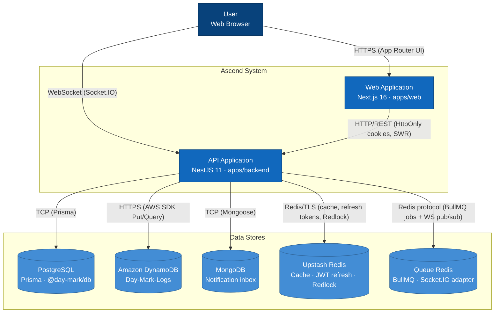

# Ascend (Day Mark)

**A daily execution and habit system that turns long-term goals into timezone-aware daily tasks — tracking streaks, XP progression, and daily history.**

*Note on naming:* The user-facing application is branded **Ascend**, while the repository, internal packages, and database schema are named **Day Mark**.

> 🌐 **Live Application:** **[https://app.ascendup.online/](https://app.ascendup.online/)**
>
> 📐 **Detailed Architecture, Technical Decisions & Engineering Trade-Offs:**
> For the full technical breakdown—including why the stack uses PostgreSQL + DynamoDB + MongoDB + dual Redis, how timezone-bucketed `BullMQ` workers and `Redlock` write-behind caching work, C4 Level 3 component diagrams, sequence flows, and engineering trade-offs—read the **[Detailed Architecture Guide (`docs/ARCHITECTURE.md`)](docs/ARCHITECTURE.md)**.

[](https://app.ascendup.online/)
[](https://nextjs.org/)
[](https://nestjs.com/)
[](https://www.prisma.io/)
[](https://turbo.build/repo)
[](https://docs.bullmq.io/)
[](https://upstash.com/)
[](https://www.typescriptlang.org/)
[](https://pnpm.io/)

---

## Video Walkthroughs

| 🔐 Auth Flow & Task Creation | 🔄 Habit Creation & Tracking |
| :---: | :---: |
| [](https://youtu.be/G5S9tzSJgGQ)<br/>[▶ **Watch Walkthrough**](https://youtu.be/G5S9tzSJgGQ) | [](https://youtu.be/oadoJzAzx1E)<br/>[▶ **Watch Walkthrough**](https://youtu.be/oadoJzAzx1E) |

| 🎯 Goal / Objective Tracking | ⚙️ Settings & Notification Flow |
| :---: | :---: |
| [](https://youtu.be/5VnbFcuxeYA)<br/>[▶ **Watch Walkthrough**](https://youtu.be/5VnbFcuxeYA) | [](https://youtu.be/5F05dFvYh7E)<br/>[▶ **Watch Walkthrough**](https://youtu.be/5F05dFvYh7E) |

---

## The Problem & Solution

**The Problem.** Setting big goals (*"get fit"*, *"read 20 books"*, *"master system design"*) is easy, but sticking to them every day is hard. Most people lose momentum with standard to-do apps for three reasons:

1. **Big goals feel too far away:** A 6-month target doesn't tell you what to execute *today*.
2. **Standard to-do lists treat everything the same:** Checking off *"buy milk"* gets treated the exact same way as showing up to study for 60 days in a row.
3. **Midnight resets ignore real schedules:** If you work until 1:30 AM, most apps mark your habit as missed at 12:00 AM, breaking your streak even though your day isn't over.

**The Solution.** Ascend (Day Mark) bridges long-term goals and daily execution:

1. **Goals turn into daily tasks:** Weekly and monthly goals spawn linked daily tasks and track completion velocity in real time.
2. **Habits run on autopilot:** You choose which weekdays a habit repeats, and background `BullMQ` workers automatically schedule and create the tasks each day.
3. **Custom day-start schedules:** Tasks respect your IANA timezone and personal `dayStartTime` — so if your morning starts at 5:00 AM, finishing a task at 2:00 AM still counts toward today.
4. **Tracked progress & history:** Completed tasks earn XP, unlock ranks, and write to an append-only history log so your consistency and daily reflections are preserved over time.

---

## System Architecture Overview

> **Core Storage Rule:** **PostgreSQL** stores identity and current state; **AWS DynamoDB** stores permanent daily audit logs and reflections; **MongoDB** holds the temporary notification inbox; **Redis** handles caching, distributed locks, and job queues.



👉 **For the full technical breakdown—including C4 Level 3 component diagrams, sequence diagrams, database trade-offs, security controls, and scalability seams—see [`docs/ARCHITECTURE.md`](docs/ARCHITECTURE.md).**

---

## Project Structure

```text
day-mark/
├── apps/
│   ├── web/                          # Next.js 16 UI (port 3001)
│   │   ├── app/                      # App Router: landing, (auth), (home), onboarding
│   │   ├── components/               # UI primitives + product sections
│   │   ├── core/                     # HTTP client, hooks, domain services, stores
│   │   ├── proxy.ts                  # Cookie auth gate + route protection
│   │   └── utils/auth.ts             # Logout hits Nest to clear HttpOnly cookies
│   └── backend/                      # NestJS 11 API (port 3000)
│       └── src/
│           ├── main.ts               # CORS, cookies, ValidationPipe, Redis IO adapter
│           ├── common/               # Prisma, Redis cache, queues, Dynamo, Mongo, guards
│           └── modules/              # auth, user, tasks, habits, goals, health, notification, gamification
├── docs/
│   └── ARCHITECTURE.md               # Detailed Architecture, Technical Decisions & Trade-Offs
├── packages/
│   ├── core/db/                      # Prisma schema, migrations, shared PrismaClient
│   ├── eslint-config/                # Shared ESLint presets
│   └── typescript-config/            # Shared tsconfig bases
├── docker-compose.yml                # Local Docker stack
├── turbo.json
├── pnpm-workspace.yaml
├── .env.example                      # Copy to .env at repo root
└── README.md
```

---

## Getting Started (Local Development)

### Prerequisites

| Tool | Version / Notes |
| :--- | :--- |
| **Node.js** | `>= 18` |
| **pnpm** | `12.4.2` (see `packageManager` in root `package.json`) |
| **Docker** | Used to run PostgreSQL, Redis, MongoDB, and DynamoDB Local |
| **PostgreSQL** | 14+ |
| **Redis** | Local instance for `QUEUE_REDIS_URL` and cache |
| **MongoDB** | Local or Atlas for the notification inbox |
| **AWS DynamoDB** | AWS account (`Day-Mark-Logs` table) or `amazon/dynamodb-local` via Docker |

### Option 1: Run Infrastructure with Docker Compose

You can spin up the local databases (**PostgreSQL**, **MongoDB**, **Redis**, and **DynamoDB Local**) using [`docker-compose.yml`](docker-compose.yml):

```bash
docker compose up -d postgres mongo redis dynamodb
```

Or run the full containerized stack:

```bash
docker compose up --build
```

### Option 2: Manual / Hot-Reload Development Setup

1. **Clone and install dependencies:**
   ```bash
   git clone https://github.com/Desktoo/Ascend.git
   cd day-mark
   pnpm install
   ```

2. **Configure environment variables:**
   ```bash
   cp .env.example .env
   ```
   Fill in the required keys in `.env`. To generate VAPID keys for Web Push:
   ```bash
   npx web-push generate-vapid-keys
   ```
   Place the public key in both `VAPID_PUBLIC_KEY` and `NEXT_PUBLIC_VAPID_PUBLIC_KEY`.

3. **Initialize PostgreSQL (Prisma):**
   ```bash
   pnpm --filter @day-mark/db db:generate
   pnpm --filter @day-mark/db db:migrate
   ```
   *(Or use `pnpm --filter @day-mark/db exec prisma db push` for a quick local schema push.)*

4. **Initialize the DynamoDB table:**
   ```bash
   pnpm --filter backend db:dynamo:setup
   ```

5. **Start both applications:**
   ```bash
   pnpm dev
   ```

| Application | Local URL |
| :--- | :--- |
| **Web App (Next.js)** | [http://localhost:3001](http://localhost:3001) |
| **Backend API (NestJS)** | [http://localhost:3000](http://localhost:3000) |

---

## Testing & Verification

Backend unit, integration, and E2E test suites run with **Vitest**:

```bash
pnpm --filter backend test
pnpm --filter backend test:int
pnpm --filter backend test:cov
pnpm --filter backend test:e2e
```

Repo-wide linting and type checking:

```bash
pnpm lint
pnpm check-types
```

---

## License

This project is licensed under the MIT License — see the [LICENSE](LICENSE) file for details.

## Author

**Akshat Krishan** · [GitHub](https://github.com/Desktoo)
