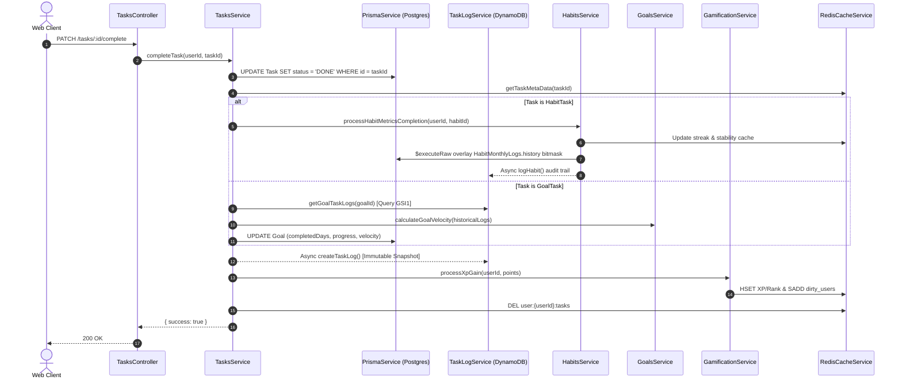
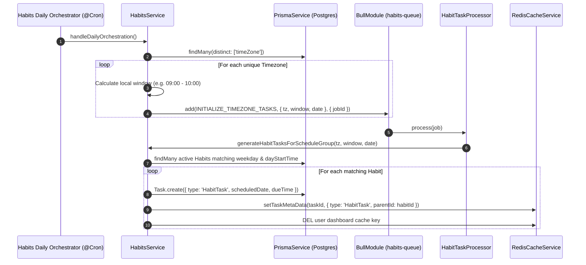

# Ascend (Day Mark) — Detailed Architecture, Technical Decisions & Trade-Offs

This document covers the backend and system architecture of **Ascend (`day-mark`)**, including why each technology in the stack was chosen, how the internal NestJS components and background workers interact (C4 Level 3), the engineering trade-offs behind the design, and the current security and scalability boundaries.

---

## Table of Contents

1. [System Overview & Core Storage Rule](#1-system-overview--core-storage-rule)
2. [Why This Tech Stack? (Technical Decisions)](#2-why-this-tech-stack-technical-decisions)
3. [C4 Level 3 Component Diagram (`apps/backend`)](#3-c4-level-3-component-diagram-appsbackend)
4. [Layer Breakdown & Component Responsibilities](#4-layer-breakdown--component-responsibilities)
5. [Key Execution Workflows (Sequence Diagrams)](#5-key-execution-workflows-sequence-diagrams)
6. [Engineering Challenges & Trade-Offs](#6-engineering-challenges--trade-offs)
7. [Persistence Strategy & Storage Matrix](#7-persistence-strategy--storage-matrix)
8. [Security, Scalability & Known Production Gaps](#8-security-scalability--known-production-gaps)

---

## 1. System Overview & Core Storage Rule

Ascend is built as a timezone-aware daily execution and scheduling engine. Instead of forcing every type of workload into a single database table, the backend separates data by how it is read, written, and deleted:

> **Core Architectural Rule:** **PostgreSQL** owns identity and current state; **AWS DynamoDB** owns immutable daily audit logs and reflections; **MongoDB** owns the disposable notification inbox; **Redis** handles hot caching, distributed locks, and background job queues.

* **Relational Core (PostgreSQL + Prisma):** Enforces foreign keys, cascading deletes, and composite uniqueness (`@@unique([habitId, scheduledDate])`) for users, accounts, goals, habits, and active tasks.
* **Append-Only Event Ledger (AWS DynamoDB):** Stores write-once task completion logs, habit execution logs, and daily reflections using a single-table design (`Day-Mark-Logs`) with `GSI1` (Goals) and `GSI2` (Habits).
* **Real-Time Notification Inbox (MongoDB + Mongoose):** Stores unread in-app notifications with a 30-day TTL index and deletes them immediately when the client sends an `ACK_NOTIFICATION` event over WebSockets.
* **Low-Latency Cache & Lock Store (Upstash Redis):** Holds cached user profiles, 7-day refresh tokens, activity timestamps, and `Redlock`-coordinated write-behind XP batches.
* **Queue & Pub/Sub Bus (Queue Redis):** Powers `BullMQ` worker queues (`habits-queue`, `notification-queue`) and the multi-instance `Socket.IO` Redis adapter.

---

## 2. Why This Tech Stack? (Technical Decisions)

### Why a Turborepo Monorepo?
The Next.js frontend (`apps/web`) and NestJS backend (`apps/backend`) share a single source of truth for the Prisma database client (`@day-mark/db`) and shared TypeScript/ESLint rules (`packages/`). Putting them in a Turborepo workspace (`dependsOn: ["^build"]`) ensures database schema changes and types stay in sync across the stack and lets a developer boot the entire project with a single command.

### Why NestJS Instead of Next.js Route Handlers?
Next.js API routes are built for short, stateless request-response cycles. Ascend's backend needs to run:
* **`@nestjs/schedule` cron jobs** (hourly timezone evaluation, reminder scheduling, 10-second Redis-to-Postgres XP batch flushes, and 4-minute DB keep-alive pings).
* **Long-running `BullMQ` worker processors** that survive beyond serverless function timeouts.
* **Persistent `Socket.IO` WebSocket connections** backed by a Redis Pub/Sub adapter so real-time events work across multiple server replicas.
* **Passport authentication strategies** (Credentials, Google, GitHub) and global DTO validation (`ValidationPipe` with `whitelist: true` and `forbidNonWhitelisted: true`).

Next.js handles UI rendering and cookie-based route protection (`apps/web/proxy.ts`), while NestJS owns all state, background workers, and database connections.

### Why Three Databases (PostgreSQL, DynamoDB, MongoDB)?
Different parts of the app have very different read and write patterns:
1. **PostgreSQL + Prisma for current state:** Users, accounts, goals, habits, and daily tasks form a relational graph. When a user deletes a goal or habit, foreign keys and cascading rules clean up linked records reliably.
2. **DynamoDB for permanent history logs:** Every completed task, habit check-in, and daily self-reflection is an append-only event that is never updated. Storing these in DynamoDB keyed by `PK: USER#<id>` and `SK` prefixes (`TASKLOG#...`, `LOG#HABIT#...`, `REFLECTION#YYYY-MM-DD`) keeps historical log growth from bloating PostgreSQL tables or slowing down active dashboard queries.
3. **MongoDB for notifications:** In-app notifications are written in bursts by background workers and deleted the moment a user sees them (`ACK_NOTIFICATION`). Running high-churn inserts and immediate deletes in MongoDB avoids constant dead-tuple cleanup (`VACUUM` overhead) in PostgreSQL.

### Why Two Redis Roles (`UPSTASH_REDIS_URL` vs `QUEUE_REDIS_URL`)?
| Redis Role | Environment Variable | What It Handles |
| :--- | :--- | :--- |
| **Cache & Lock Redis** | `UPSTASH_REDIS_URL` | User profile cache, notification preferences (`user:{id}:notification_prefs`), JWT refresh tokens (`refresh:{id}`), XP progression hashes, dirty-user sets, and `Redlock` distributed locks. |
| **Queue & Pub/Sub Redis** | `QUEUE_REDIS_URL` | `BullMQ` job streams (`maxRetriesPerRequest: null` required for blocking commands) and the `Socket.IO` Redis Pub/Sub adapter. |

Mixing `BullMQ` blocking queue connections with a serverless request-priced Redis cache is a common production pitfall. Separating the two connections in code lets you run a persistent Redis instance for queues while keeping hot cache keys isolated.

### Why Next.js 16 + SWR + Zustand on the Frontend?
* **Next.js 16 (`apps/web`):** Handles App Router pages, server components, and the edge cookie check (`proxy.ts`) that redirects unauthenticated users before protected dashboard pages render.
* **SWR:** Manages client-side server state, caching, and revalidation against the NestJS API.
* **Zustand:** Manages lightweight local UI state (such as active modals and overlays) without unnecessary context re-renders.
* **Zod + React Hook Form:** Validates form inputs on the client before requests ever hit the API.

---

## 3. C4 Level 3 Component Diagram (`apps/backend`)

The diagram below shows all internal NestJS modules, controllers, guards, domain services, background processors, infrastructure adapters, and external data stores.

```mermaid
flowchart TD

    %% =========================================================================
    %% SUBGRAPH 1: ENTRY & CONTROL LAYER
    %% =========================================================================
    subgraph EntryLayer ["1. Entry & Control Layer (Controllers, Guards & Gateway)"]
        ValidationPipe["ValidationPipe<br/><i>(Global DTO Validation & Whitelisting)</i>"]
        AuthGuard["AuthGuard & Passport Strategies<br/><i>(JWT Verification & Google/GitHub OAuth)</i>"]
        
        AuthCtrl["AuthController<br/><i>(/auth - Login, Signup, Refresh, Reset, OAuth)</i>"]
        UserCtrl["UserController<br/><i>(/user - Profile, Timezone, Activity, Reflection)</i>"]
        TasksCtrl["TasksController<br/><i>(/tasks - Task CRUD, Dashboard, Reschedule)</i>"]
        HabitsCtrl["HabitsController<br/><i>(/habits - CRUD, Toggle, Heatmap Logs)</i>"]
        GoalsCtrl["GoalsController<br/><i>(/goals - Blueprints, Sprints, Planning)</i>"]
        NotificationCtrl["NotificationController<br/><i>(/notifications - Prefs, WebPush Subscriptions)</i>"]
        HealthCtrl["HealthController<br/><i>(/health - Liveness & Compute Warmup)</i>"]
        
        NotificationGateway["NotificationGateway<br/><i>(Socket.IO WebSocket Server & ACK Sweeper)</i>"]
    end

    %% =========================================================================
    %% SUBGRAPH 2: DOMAIN & APPLICATION SERVICES
    %% =========================================================================
    subgraph DomainServices ["2. Domain & Application Services"]
        AuthSvc["AuthService<br/><i>(Credentials, Token Issuance, Password Reset)</i>"]
        AuthCacheRepo["AuthCacheRepository<br/><i>(Refresh Token Key Management)</i>"]
        
        UserSvc["UserService<br/><i>(Identity Lifecycle, Accounts & Profile Resolution)</i>"]
        UserCacheRepo["UserCacheRepository<br/><i>(Core Profile Cache Layer)</i>"]
        SelfReflectionSvc["SelfReflectionService<br/><i>(Daily Reflection Logging & Task Planning)</i>"]
        UserActivitySvc["UserActivityService<br/><i>(Fast In-Memory Heartbeat Collector)</i>"]
        
        TasksSvc["TasksService<br/><i>(Task Orchestration, Completion & XP Triggers)</i>"]
        TasksCacheRepo["TasksCacheRepository<br/><i>(Task Routing Metadata Cache)</i>"]
        
        HabitsSvc["HabitsService<br/><i>(Habit Orchestration, Streaks & Stability Score)</i>"]
        HabitsCacheRepo["HabitsCacheRepository<br/><i>(Streak & Stability Cache Store)</i>"]
        
        GoalsSvc["GoalsService<br/><i>(Goal Progress & Velocity Calculator)</i>"]
        
        NotificationSvc["NotificationService<br/><i>(Multi-Channel Dispatcher & Policy Enforcer)</i>"]
        InAppProv["InAppProvider<br/><i>(MongoDB Persistence & Socket Dispatch)</i>"]
        WebPushProv["WebPushProvider<br/><i>(VAPID Web Push Payload Deliverer)</i>"]
        
        GamificationSvc["GamificationService<br/><i>(XP Progress Math & Distributed Write-Behind)</i>"]
        GamificationCacheRepo["GamificationCacheRepository<br/><i>(Dirty Set & Rank State Cache)</i>"]
        
        HealthSvc["HealthService<br/><i>(Database Pool Warmup Engine)</i>"]
    end

    %% =========================================================================
    %% SUBGRAPH 3: BACKGROUND PROCESSING & SCHEDULERS
    %% =========================================================================
    subgraph BackgroundProcessing ["3. Background Processing & Schedulers (BullMQ & Crons)"]
        NotificationCron["NotificationCron<br/><i>(@Cron EVERY_HOUR: Enqueues Dynamic Reminders)</i>"]
        HabitsCron["Habits Daily Orchestrator<br/><i>(@Cron 0 * * * *: Timezone Window Enqueue)</i>"]
        UserActivityCron["UserActivitySyncCron<br/><i>(@Cron EVERY_HOUR: LastActive Batch Sync)</i>"]
        GamificationCron["GamificationSyncCron<br/><i>(@Cron EVERY_10_SECONDS: Redis-to-DB Flush)</i>"]
        HealthCron["HealthCron<br/><i>(@Cron */4 * * * *: DB Keep-Alive Heartbeat)</i>"]
        
        HabitTaskProcessor["HabitTaskProcessor<br/><i>(BullMQ Worker: habits-queue)</i>"]
        NotificationProcessor["NotificationProcessor<br/><i>(BullMQ Worker: notification-queue)</i>"]
    end

    %% =========================================================================
    %% SUBGRAPH 4: SHARED INFRASTRUCTURE ADAPTERS
    %% =========================================================================
    subgraph InfrastructureAdapters ["4. Shared Infrastructure Adapters (src/common)"]
        PrismaSvc["PrismaService<br/><i>(PostgreSQL Client & Transaction Manager)</i>"]
        RedisCacheSvc["RedisCacheService<br/><i>(Upstash Redis Client & Redlock Distributed Locks)</i>"]
        DynamoDbSvc["DynamoDbService<br/><i>(AWS DynamoDB Document Client)</i>"]
        TaskLogSvc["TaskLogService<br/><i>(Immutable Task Completion Logs & GSI1/2 Queries)</i>"]
        HabitLogSvc["HabitLogService<br/><i>(Single-Table Habit Audit Ledger Logs)</i>"]
        MongoDbMod["MongoDatabaseModule / Mongoose<br/><i>(Mongoose AppNotification Document Model)</i>"]
        RedisIOAdapter["RedisIOAdapter<br/><i>(Socket.IO Redis Pub/Sub Multi-Pod Adapter)</i>"]
        BullQueueMod["BullModule / LocalRedisModule<br/><i>(BullMQ Queue Driver & Redis Connection)</i>"]
    end

    %% =========================================================================
    %% SUBGRAPH 5: EXTERNAL INFRASTRUCTURE TARGETS
    %% =========================================================================
    subgraph ExternalTargets ["5. External Infrastructure & Persistence Targets"]
        PostgresDB[("PostgreSQL Database<br/><i>(Users, Accounts, Tasks, Habits, Goals, MonthlyLogs, XP)</i>")]
        UpstashRedisDB[("Upstash Redis<br/><i>(Core Profiles, Refresh Tokens, Gamification Hashes, Redlock)</i>")]
        QueueRedisDB[("Queue Redis<br/><i>(BullMQ Queues & Socket.IO Pub/Sub Bus)</i>")]
        DynamoDBTable[("AWS DynamoDB Table<br/><i>('Day-Mark-Logs' Table with GSI1 & GSI2)</i>")]
        MongoDBCluster[("MongoDB Cluster<br/><i>(In-App Notification Inbox with 30-Day TTL Index)</i>")]
    end

    %% =========================================================================
    %% PIPELINE & ENTRY LEVEL ROUTING
    %% =========================================================================
    ValidationPipe -- "Validates & Sanitizes DTOs" --> AuthCtrl
    ValidationPipe -- "Validates & Sanitizes DTOs" --> UserCtrl
    ValidationPipe -- "Validates & Sanitizes DTOs" --> TasksCtrl
    ValidationPipe -- "Validates & Sanitizes DTOs" --> HabitsCtrl
    ValidationPipe -- "Validates & Sanitizes DTOs" --> GoalsCtrl
    ValidationPipe -- "Validates & Sanitizes DTOs" --> NotificationCtrl

    AuthGuard -- "Protects Route & Attaches User ID" --> UserCtrl
    AuthGuard -- "Protects Route & Attaches User ID" --> TasksCtrl
    AuthGuard -- "Protects Route & Attaches User ID" --> HabitsCtrl
    AuthGuard -- "Protects Route & Attaches User ID" --> GoalsCtrl

    %% =========================================================================
    %% CONTROLLER TO SERVICE INTERACTIONS
    %% =========================================================================
    AuthCtrl -- "Validates & Rotates Session" --> AuthSvc
    AuthCtrl -- "Creates Profile & Accounts (Tx)" --> UserSvc
    AuthCtrl -- "Runs Sign-Up Transaction" --> PrismaSvc

    UserCtrl -- "Fetches / Updates User Matrix" --> UserSvc
    UserCtrl -- "Submits Daily Reflection" --> SelfReflectionSvc
    UserCtrl -- "Fast In-Memory Heartbeat Ping" --> UserActivitySvc

    TasksCtrl -- "Delegates CRUD & Actions" --> TasksSvc

    HabitsCtrl -- "Delegates CRUD & Analytics" --> HabitsSvc

    GoalsCtrl -- "Delegates Goal Orchestration" --> GoalsSvc
    GoalsCtrl -- "Queries Workspace Goal Logs" --> TaskLogSvc

    NotificationCtrl -- "Updates Preferences & WebPush Keys" --> NotificationSvc
    HealthCtrl -- "Initiates Connection Warmup" --> HealthSvc

    %% =========================================================================
    %% AUTH & USER DOMAIN INTERACTIONS
    %% =========================================================================
    AuthSvc -- "Finds User & Account Credentials" --> UserSvc
    AuthSvc -- "Stores Password Reset Token (TTL 5m)" --> RedisCacheSvc
    AuthSvc -- "Manages Refresh Token Key Store" --> AuthCacheRepo
    AuthCacheRepo -- "Caches Token Hash (TTL 7d)" --> RedisCacheSvc

    UserSvc -- "Reads / Writes User Profile & Accounts" --> PrismaSvc
    UserSvc -- "Caches Core Profile (Write-Through)" --> UserCacheRepo
    UserSvc -- "Queries Gamification State" --> GamificationCacheRepo
    UserSvc -- "Verifies Existing Daily Reflection" --> DynamoDbSvc
    UserCacheRepo -- "Stores Profile JSON" --> RedisCacheSvc

    UserActivitySvc -- "HSET user:last_active Timestamp" --> RedisCacheSvc
    UserActivitySvc -- "Batch Updates User.lastActive" --> PrismaSvc
    UserActivityCron -- "Triggers Hourly Activity Sync" --> UserActivitySvc

    SelfReflectionSvc -- "Persists Reflection Item" --> DynamoDbSvc
    SelfReflectionSvc -- "Spawns Tomorrow Tasks" --> TasksSvc

    %% =========================================================================
    %% TASK, HABIT & GOAL DOMAIN INTERACTIONS
    %% =========================================================================
    TasksSvc -- "Task State Mutation (PENDING/DONE)" --> PrismaSvc
    TasksSvc -- "Caches Dashboard & User Task Lists" --> RedisCacheSvc
    TasksSvc -- "Caches Routing Parent Metadata" --> TasksCacheRepo
    TasksCacheRepo -- "Sets Task Type / ParentId (TTL 24h)" --> RedisCacheSvc
    TasksSvc -- "Triggers XP Gain Math" --> GamificationSvc
    TasksSvc -- "Appends Async Task Audit Trail" --> TaskLogSvc
    TasksSvc -- "Updates Habit Completion Metrics" --> HabitsSvc
    TasksSvc -- "Updates Goal Completion & Velocity" --> GoalsSvc
    TaskLogSvc -- "Writes Task Log & GSI Indexes" --> DynamoDbSvc

    HabitsSvc -- "CRUD & Monthly History Bitmask Overlay" --> PrismaSvc
    HabitsSvc -- "Caches Streaks & Stability Metrics" --> HabitsCacheRepo
    HabitsCacheRepo -- "HSET Habit Streaks & Scores" --> RedisCacheSvc
    HabitsSvc -- "Enqueues Timezone Windows" --> BullQueueMod
    HabitsSvc -- "Appends Habit Execution Checkpoint" --> HabitLogSvc
    HabitLogSvc -- "Writes Habit Log Ledger" --> DynamoDbSvc
    HabitsCron -- "Fires Timezone Window Evaluation" --> HabitsSvc
    HabitTaskProcessor -- "Processes Window Batch Job" --> HabitsSvc
    HabitTaskProcessor -- "Consumes habits-queue" --> BullQueueMod

    GoalsSvc -- "Transactional Blueprint Setup" --> PrismaSvc
    GoalsSvc -- "Creates Initial Goal Task" --> TasksSvc
    GoalsSvc -- "Queries Historic Logs for Velocity" --> TaskLogSvc

    %% =========================================================================
    %% NOTIFICATION DOMAIN & REALTIME INTERACTIONS
    %% =========================================================================
    NotificationSvc -- "Upserts Prefs & Push Subscriptions" --> PrismaSvc
    NotificationSvc -- "Caches Notification Prefs (TTL 24h)" --> RedisCacheSvc
    NotificationSvc -- "Fetches Unread Offline Notifications" --> MongoDbMod
    NotificationSvc -- "Dispatches to In-App Channel" --> InAppProv
    NotificationSvc -- "Dispatches to Web Push Channel" --> WebPushProv

    InAppProv -- "Persists Notification Document" --> MongoDbMod
    InAppProv -- "Broadcasts Realtime Notification" --> NotificationGateway
    WebPushProv -- "Fetches User Push Subscriptions" --> PrismaSvc

    NotificationGateway -- "Redis Pub/Sub Broadcast Adapter" --> RedisIOAdapter
    NotificationGateway -- "Deletes ACK'd Notification Item" --> MongoDbMod

    NotificationCron -- "Queries Users for Dynamic Schedule" --> PrismaSvc
    NotificationCron -- "Enqueues Notification Jobs" --> BullQueueMod
    NotificationProcessor -- "Consumes notification-queue" --> BullQueueMod
    NotificationProcessor -- "Dispatches Web Push Alert" --> WebPushProv

    %% =========================================================================
    %% GAMIFICATION & HEALTH INTERACTIONS
    %% =========================================================================
    GamificationSvc -- "Reads / Updates Active Rank & XP" --> GamificationCacheRepo
    GamificationCacheRepo -- "HSET XP/Level & SADD Dirty Set" --> RedisCacheSvc
    GamificationCron -- "Triggers Write-Behind Sync" --> GamificationSvc
    GamificationSvc -- "Acquires Redlock Lock ('locks:user-db-sync')" --> RedisCacheSvc
    GamificationSvc -- "Batch Flushes User XP & XpTransactions" --> PrismaSvc

    HealthSvc -- "Executes SELECT 1 Compute Ping" --> PrismaSvc
    HealthCron -- "Triggers Periodic Warmup Heartbeat" --> HealthSvc

    %% =========================================================================
    %% INFRASTRUCTURE ADAPTERS TO PERSISTENCE TARGETS
    %% =========================================================================
    PrismaSvc -- "TCP Connection Pool / SQL Transactions" --> PostgresDB
    RedisCacheSvc -- "RESP Protocol (Strings, Hashes, Sets, Redlock)" --> UpstashRedisDB
    BullQueueMod -- "BullMQ Queue Engine & Streams" --> QueueRedisDB
    RedisIOAdapter -- "Socket.IO Multi-Pod Cluster Sync" --> QueueRedisDB
    DynamoDbSvc -- "AWS SDK Document Client (Put/Query/Delete)" --> DynamoDBTable
    MongoDbMod -- "Mongoose Driver (BSON / TTL Indexes)" --> MongoDBCluster
```

---

## 4. Layer Breakdown & Component Responsibilities

### 4.1 Entry & Control Layer

1. **Global Pipeline (`main.ts`):**
   * **`ValidationPipe`:** Validates incoming request bodies against DTO classes with `whitelist: true` and `forbidNonWhitelisted: true`.
   * **Cookie Parser:** Extracts `HttpOnly` cookies (`access_token`, `refresh_token`) from incoming requests.
   * **CORS & WebSocket Adapter:** Attaches `RedisIOAdapter` to Socket.IO so events broadcast across multiple backend instances.
2. **`AuthGuard` (`src/common/gaurds/auth.gaurds.ts`):**
   * Reads `req.cookies.access_token`, verifies the signature using `env.JWT_ACCESS_SECRET`, and attaches `{ userId: decoded.userId }` to the request object.
3. **`NotificationGateway` (`gateways/notification.gateway.ts`):**
   * Places connected sockets into `user:${userId}` rooms.
   * Pushes `NEW_NOTIFICATION` events from `InAppProvider`.
   * Listens for `ACK_NOTIFICATION` events and immediately deletes the acknowledged document from MongoDB.

---

### 4.2 Domain Services & Repositories

| Component | Responsibility | Persistence / Cache Target |
| :--- | :--- | :--- |
| **`AuthService`** | Credential verification, token issuance (`access_token` 15m, `refresh_token` 7d), OAuth account linking, password reset tokens via Resend. | Upstash Redis (`refresh:{userId}`, `password-reset:{token}`), PostgreSQL |
| **`UserService`** | User profile lookups, write-through profile caching, timezone and `dayStartTime` updates, onboarding completion. | PostgreSQL (`User`, `Account`), Upstash Redis (`user:{userId}:core_profile`) |
| **`UserActivityService`** | Fast in-memory activity tracking (`<2ms`), writing ISO timestamps to a Redis Hash before hourly batch syncs. | Upstash Redis (`user:last_active`), PostgreSQL (hourly batch sync) |
| **`SelfReflectionService`** | Computes the user's logical day (`dayStartTime` + `timeZone`), enforces one reflection per day, saves reflection logs, and schedules tomorrow's tasks. | DynamoDB (`USER#{userId}`, `REFLECTION#{YYYY-MM-DD}`), PostgreSQL (`Task`) |
| **`TasksService`** | Task CRUD, active-vs-abandoned date filtering, task completion side effects, routing metadata cache, XP triggers. | PostgreSQL (`Task`), Upstash Redis (`user:{userId}:tasks`, `task:meta:{taskId}`) |
| **`HabitsService`** | Habit CRUD, timezone window grouping, monthly 31-char string updates (`S`/`D`), streak and stability score math. | PostgreSQL (`Habit`, `HabitMonthlyLogs`), Upstash Redis (`habit:{userId}:{habitId}:meta`) |
| **`GoalsService`** | Goal blueprints, sprint targets, progress percentage, and velocity calculations. | PostgreSQL (`Goal`), DynamoDB (via `TaskLogService`) |
| **`NotificationService`** | Channel provider registry (`IN_APP`, `WEB_PUSH`), preference caching, template payload resolution. | Upstash Redis (`user:{userId}:notification_prefs`), PostgreSQL (`NotificationPreference`, `PushSubscription`) |
| **`GamificationService`** | XP progression math (`calculateXpProgression`), rank themes, and Redlock write-behind batch syncing. | Upstash Redis (Hashes & Dirty Sets), PostgreSQL (`User.xp`, `XpTransaction`) |
| **`HealthService`** | Database connection keep-alive and liveness checks (`SELECT 1`). | PostgreSQL (`$queryRaw`) |

---

### 4.3 Background Processing & Scheduling

1. **`HabitsCron` (`0 * * * *`):**
   * Queries distinct user timezones from PostgreSQL (`findMany({ distinct: ['timeZone'] })`).
   * Computes the current local hour window (`windowStartMinutes` to `windowEndMinutes`) in each timezone.
   * Enqueues `HABIT_JOBS.INITIALIZE_TIMEZONE_TASKS` into `habits-queue` with a deterministic job ID (`init_window:{tz}-H{hh}:{date}`).
2. **`HabitTaskProcessor` (`habits-queue` Worker):**
   * Consumes timezone window jobs from BullMQ.
   * Calls `HabitsService.generateHabitTasksForScheduleGroup()` to create daily `HabitTask` rows and invalidate cached task lists.
3. **`NotificationCron` (`@Cron(CronExpression.EVERY_HOUR)`):**
   * Evaluates user `dayStartTime` settings and computes delays for Start-Day, Mid-Day (+6h), and End-Day (+12h) reminders.
   * Enqueues `send-notification` jobs into `notification-queue` with date-stamped deduplication IDs.
4. **`NotificationProcessor` (`notification-queue` Worker):**
   * Consumes queued reminder jobs, resolves templates, and dispatches alerts through `WebPushProvider` and `InAppProvider`.
5. **`GamificationSyncCron` (`@Cron(CronExpression.EVERY_10_SECONDS)`):**
   * Runs a **Write-Behind Cache Engine**.
   * Acquires a distributed lock (`locks:user-db-sync`, 8000ms TTL) via `Redlock`.
   * Reads the `dirty_users` set from Redis, flushes updated XP/Level values and `XpTransaction` rows to PostgreSQL in a single `$transaction`, and clears flushed users from the dirty set.
6. **`UserActivityCron` (`@Cron(CronExpression.EVERY_HOUR)`):**
   * Reads pending timestamps from the `user:last_active` Redis Hash, bulk-updates `User.lastActive` in PostgreSQL inside a `$transaction`, and removes synced keys via pipelined `HDEL`.
7. **`HealthCron` (`@Cron('*/4 * * * *')`):**
   * Sends a lightweight `SELECT 1` ping every 4 minutes so serverless Postgres instances do not cold-pause during quiet periods.

---

## 5. Key Execution Workflows (Sequence Diagrams)

### 5.1 Task Completion & Dual-Ledger Sync

---

### 5.2 Timezone-Aware Habit Materialization Pipeline

---

## 6. Engineering Challenges & Trade-Offs

### 6.1 Timezone-Correct Habit Scheduling Without Full-Table Scans
* **Problem:** A habit scheduled for `09:00` in `Asia/Kolkata` fires hours ahead of `09:00` in `America/Los_Angeles`. Running a cron every minute that scans all users in PostgreSQL does not scale and breaks across Daylight Saving Time transitions.
* **Solution in Code:** `HabitsCron` queries only distinct IANA `timeZone` values once per hour, computes the local 60-minute window (`windowStartMinutes` to `windowEndMinutes`), and enqueues a job on `habits-queue` carrying `{ timeZone, windowStartMinutes, windowEndMinutes, localDateString }`. `HabitTaskProcessor` then materializes tasks in the background with 3 exponential-backoff retries (`2s` base).
* **Trade-Off:** BullMQ uses at-least-once delivery, meaning a worker crash mid-batch can re-run a window job. To prevent duplicate daily tasks without distributed two-phase commits, jobs use deterministic IDs (`init_window:{timeZone}-H{HH}:{YYYY-MM-DD}`) and PostgreSQL enforces a composite unique constraint (`@@unique([habitId, scheduledDate])`).

### 6.2 Multi-Database Write Paths & O(1) Monthly Heatmaps
* **Problem:** Checking off a single habit task updates the task status, recalculates streaks, updates the monthly calendar heatmap, awards XP, and writes an audit log. Doing all of that synchronously across multiple databases would make every click slow, and querying 31 separate rows per habit to render a monthly heatmap creates heavy read amplification.
* **Solution in Code:**
  * **Synchronous critical path vs. async audit log:** PostgreSQL and Redis handle the immediate state update while DynamoDB audit logs (`TaskLogService` / `HabitLogService`) are written asynchronously off the critical path.
  * **Fixed-width 31-character monthly string:** Instead of storing 31 rows per month in PostgreSQL, `HabitMonthlyLogs` stores a single 31-character string (such as `"SSDSS..."` for Scheduled/Done) indexed by `yearMonth` and updated in-place via positional SQL overlay (`$executeRaw`). Rendering a month's heatmap requires only a single row read.
  * **Write-behind XP batching:** Rapid task completions increment XP in Redis (`HSET` + `SADD dirty_users`) and flush to PostgreSQL in bulk every 10 seconds under a `Redlock` mutex (`locks:user-db-sync`).
* **Trade-Off:** Running PostgreSQL, DynamoDB, MongoDB, and Redis introduces more operational moving parts than a single database, and if an async DynamoDB write fails after PostgreSQL commits, the relational streak counter and the historical audit log can briefly diverge.

### 6.3 Cookie-Based JWT Rotation vs. `localStorage`
* **Problem:** Storing access tokens in browser `localStorage` exposes them to XSS scripts, while keeping tokens only in memory logs users out on every page refresh.
* **Solution in Code:** NestJS sets `HttpOnly`, `sameSite: 'lax'` cookies for both `access_token` (15m) and `refresh_token` (7d). Active refresh tokens are stored in Redis (`refresh:{userId}`, 7-day TTL) and verified on `POST /auth/refresh`. If a stolen or old refresh token is replayed after rotation, the Redis comparison fails and invalidates the session. Passwords are hashed with `bcrypt(password + BCRYPT_SECRET_PEPPER)`.
* **Trade-Off:** Cookie authentication requires explicit origin-locked CORS (`credentials: true`) rather than wildcard `*` origins, coupling frontend and backend domain configuration during deployment.

### 6.4 Multi-Channel Notifications (Socket.IO vs. Web Push)
* **Problem:** WebSockets only reach users who have an open browser tab, while Web Push requires service workers and VAPID keys. Meanwhile, storing every notification forever bloats the database.
* **Solution in Code:** `NotificationService` dispatches through registered channel providers (`InAppProvider` and `WebPushProvider`). When a user receives an in-app alert over Socket.IO, the client emits `ACK_NOTIFICATION` and the gateway deletes the MongoDB document immediately; unacknowledged alerts for offline users expire automatically via a 30-day MongoDB TTL index.
* **Trade-Off:** The hourly reminder cron currently bounds its query with `take: 100` to cap memory usage per run. Supporting a large user base requires replacing `take: 100` with cursor pagination or timezone-bucketed batches.

---

## 7. Persistence Strategy & Storage Matrix

| Storage Target | Engine | Schemas / Models / Keys | Read/Write Access Pattern | Lifecycle / Eviction Policy |
| :--- | :--- | :--- | :--- | :--- |
| **PostgreSQL** | Relational DB (Prisma ORM) | `User`, `Account`, `Task`, `Habit`, `Goal`, `HabitMonthlyLogs`, `XpTransaction`, `NotificationPreference`, `PushSubscription` | Strongly consistent ACID transactions, relational joins, unique constraint enforcement. | Permanent system of record with relational cascading deletes. |
| **AWS DynamoDB** | NoSQL Key-Value / Wide-Column | Table: `Day-Mark-Logs` `PK: USER#{id}` `SK: TASKLOG#...` / `LOG#HABIT#...` / `REFLECTION#...` GSIs: `GSI1` (Goals), `GSI2` (Habits) | High-volume append-only audit trail writes; prefix and GSI partition queries. | Immutable historical ledger; chunked batch deletes (25 items) on account/habit deletion. |
| **MongoDB** | Document Store (Mongoose) | Collection: `appnotifications` Fields: `userId`, `title`, `body`, `type`, `data`, `createdAt` | Burst inbox writes from background workers; unread fetches on login. | **30-Day TTL index** on `createdAt`; immediate deletion on WebSocket `ACK_NOTIFICATION`. |
| **Upstash Redis** | In-Memory Key-Value / Hash Store | Keys: `refresh:{id}`, `password-reset:{token}`, `user:{id}:core_profile`, `habit:{id}:{id}:meta`, `user:{id}:notification_prefs`, `dirty_users`, `user:last_active` | Sub-millisecond reads/writes; session verification and dirty-set tracking. | Explicit TTLs (`refresh` 7d, `reset` 5m, `profile` 24h); `Redlock` distributed mutexes (8s). |
| **Queue Redis** | In-Memory Stream / Message Bus | BullMQ streams (`habits-queue`, `notification-queue`), Socket.IO Redis pub/sub channels. | Background job buffering and WebSocket event fan-out across API pods. | Completed jobs pruned after 300s/50 count; failed jobs retained up to 3600s/100 count. |

---

## 8. Security, Scalability & Known Production Gaps

### Implemented Security Controls

| Control | Implementation |
| :--- | :--- |
| **Authentication** | Short-lived JWT `access_token` + Redis-verified `refresh_token` rotation (`refresh:{userId}`). |
| **Authorization** | Route guards extract `userId` from the verified token; MongoDB notification deletes are scoped by `userId`. |
| **Fail-Fast Env Validation** | Zod schema (`apps/backend/src/config/env.ts` & `apps/web/core/config/env.ts`) validates required keys at startup. |
| **Input Validation** | Global NestJS `ValidationPipe` (`whitelist` + `forbidNonWhitelisted`) on DTOs; Zod validation on frontend forms. |
| **Cookie Security** | `HttpOnly`, `sameSite: 'lax'` cookies; logout clears both cookies from NestJS. |
| **Password Hashing** | `bcrypt` (cost 10) combined with a server-side `BCRYPT_SECRET_PEPPER`. |
| **OAuth Account Linking** | Google and GitHub Passport strategies linked inside a Prisma `$transaction`. |

### Scalability Seams Built Into the Code
* **Stateless API + Redis Socket.IO Adapter:** Multiple NestJS instances can broadcast to the same `user:{userId}` room.
* **Background Queue Offloading:** Habit task generation and notification delivery run in BullMQ workers outside the HTTP request thread.
* **Write-Behind Batching:** High-frequency XP updates and `lastActive` pings buffer in Redis and flush to PostgreSQL in scheduled batch transactions.
* **Database Indexing:** Indexed on `Task(userId, scheduledDate)`, `Habit(userId)`, `Goal(userId)`, and `@@unique([habitId, scheduledDate])`.

### Known Gaps & Next Steps for Production Hardening
1. **Authenticate WebSocket Handshakes:** `NotificationGateway` currently has `origin: '*'` and reads `handshake.query.userId`. Before public deployment, the Socket.IO connection middleware needs to verify the signed `HttpOnly` `access_token` cookie directly.
2. **Paginate the Reminder Cron:** Replace the `take: 100` limit in `NotificationCron` with cursor-based pagination or timezone-bucketed jobs with deterministic `(userId, logicalDate, reminderKind)` job IDs.
3. **Constrained Goal-to-Habit Planner:** Add a structured planner that decomposes long-horizon `Goal` records into scheduled `Habit` rows that the existing BullMQ workers automatically materialize.
4. **CI Pipeline & Automated Test Gate:** Run the backend `Vitest` unit, integration (`vitest.int.config.ts`), and E2E suites plus `pnpm check-types` in GitHub Actions on every pull request.
